<p align="center">
  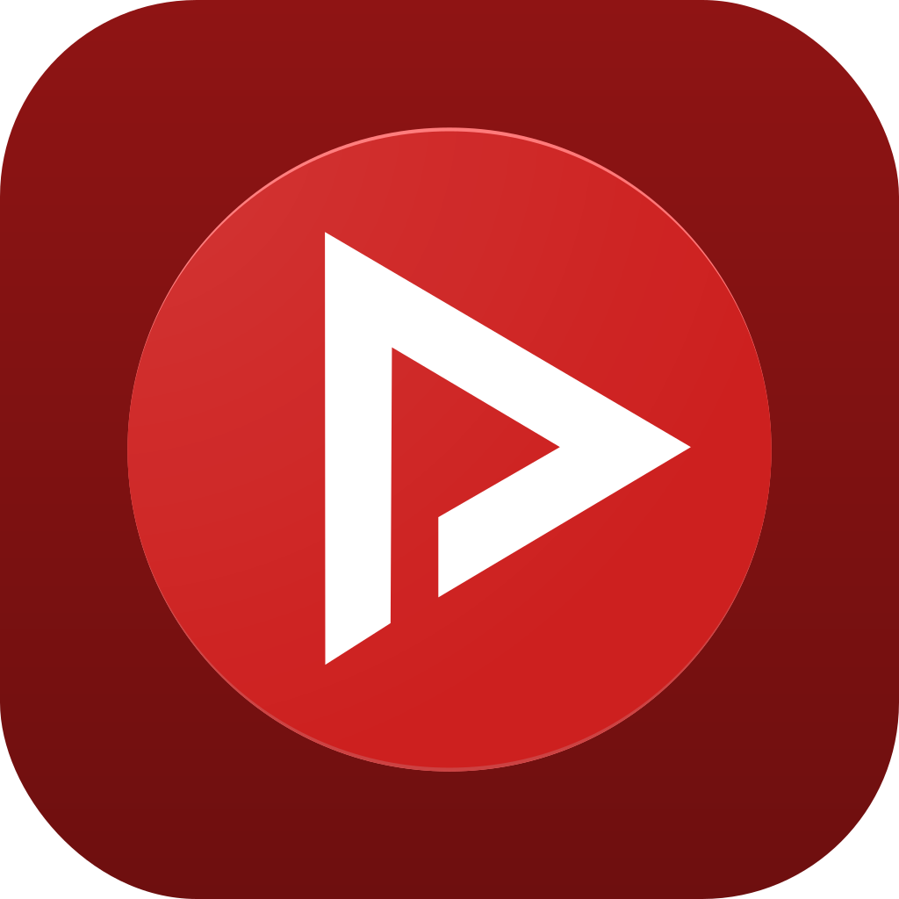
</p>

<h1 align="center">oldpipe</h1>

<p align="center">
  A lightweight, ad-free, account-free YouTube client for <b>iOS 5 through 12</b>.<br>
  Written in Swift, built for hardware Google gave up on more than a decade ago.
</p>

<p align="center">
  
  
  
</p>

---

## Philosophy

oldpipe follows the same principles as [NewPipe](https://newpipe.net) on Android:

- **No ads.** Not blocked, not skipped — never requested in the first place.
- **No account, no sign-in.** You cannot log in, so there is nothing to log in *to*.
- **No tracking.** No analytics SDK, no crash reporter, no telemetry, no phone-home. The
  app's own crash log stays on the device.
- **No Google frameworks.** The app talks to YouTube's own internal `innertube` endpoints
  directly over HTTPS. No YouTube SDK, no Play Services, no API key, no quota.
- **Your data stays on your device.** Subscriptions, playlists, watch history and
  downloads live in `UserDefaults` and the app sandbox. Nothing is ever uploaded.
- **Old hardware deserves good software.** An iPhone 4S is a perfectly capable video
  player. The only thing that stopped working was the software.

> oldpipe is an independent project. It is not affiliated with, endorsed by, or connected
> to YouTube, Google LLC, or the NewPipe project.

---

## Screenshots

### iPhone 4 — iOS 5 / 6

| Search | Video | Playing |
|---|---|---|
| 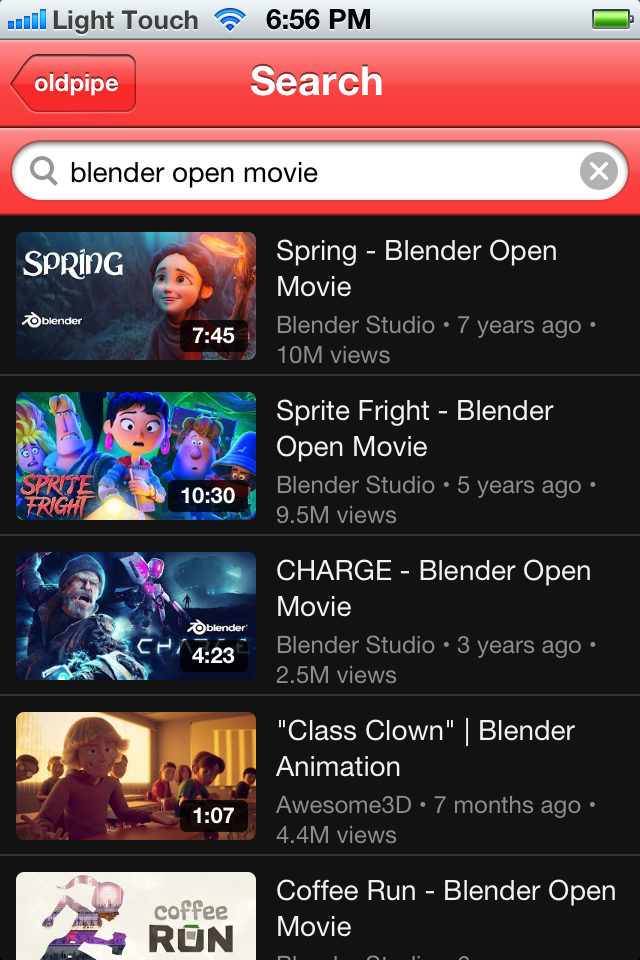 | 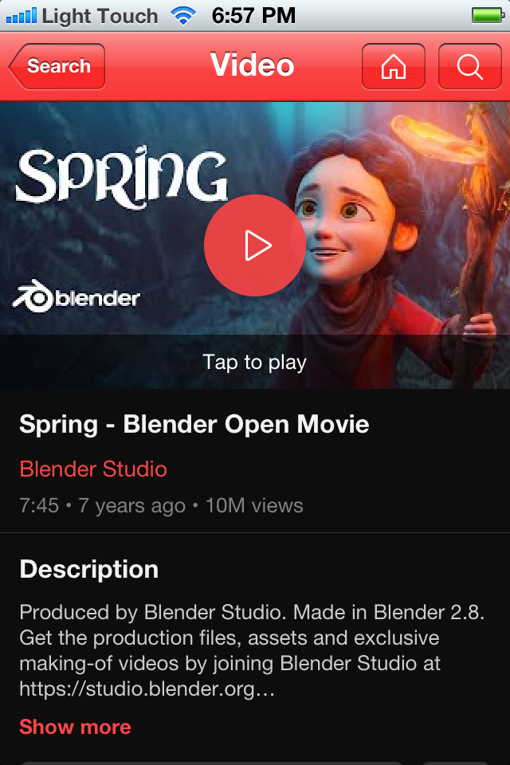 | 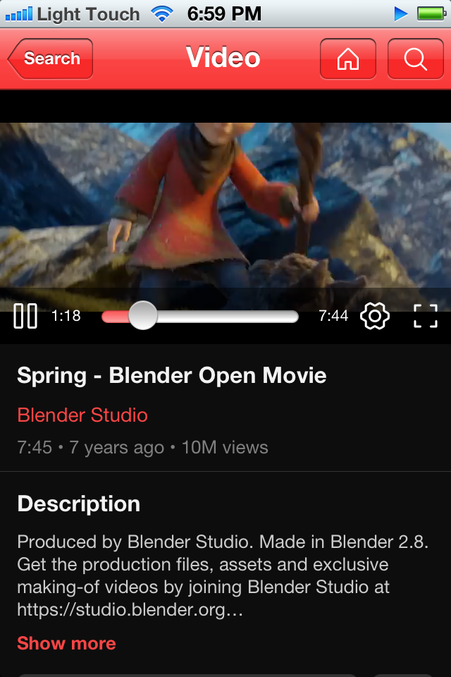 |

| Channel | Menu |
|---|---|
| 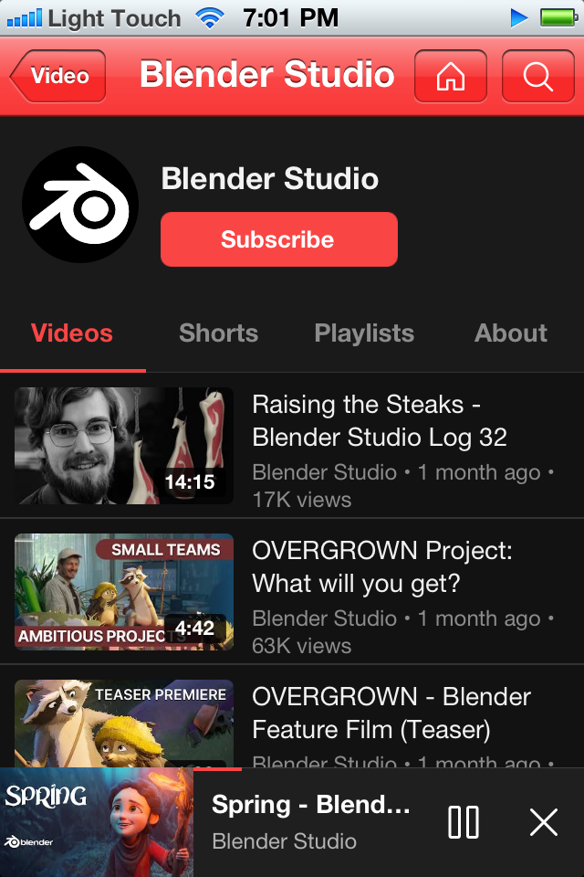 | 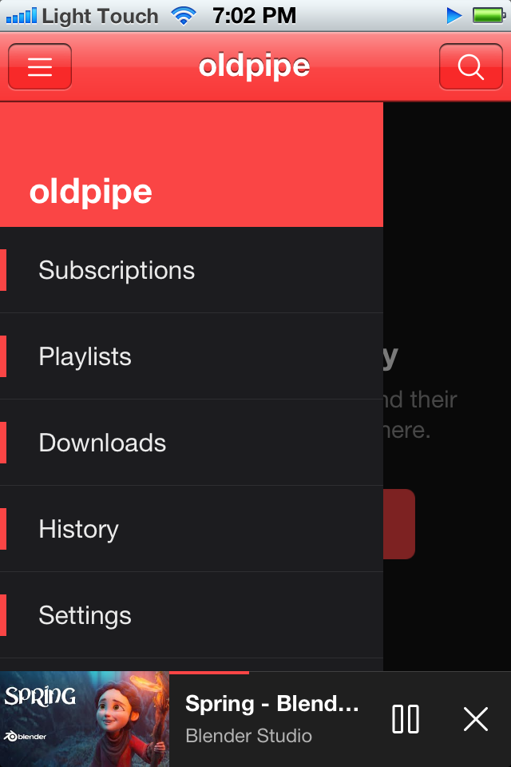 |

### iPhone 5 — iOS 7

| Search | Channel |
|---|---|
| 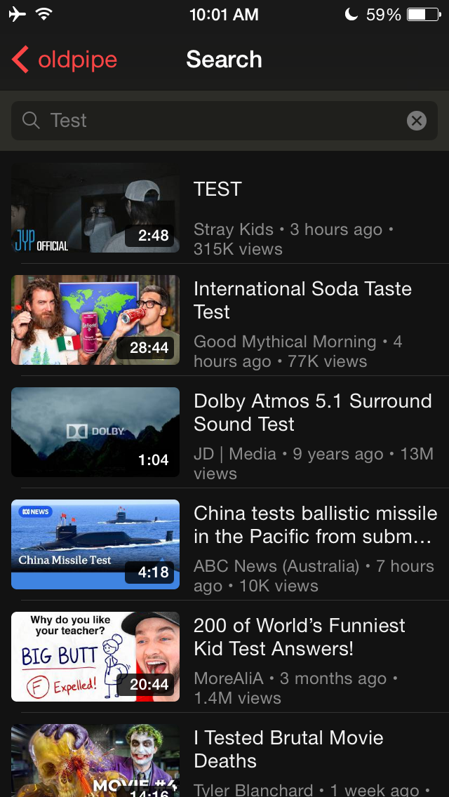 | 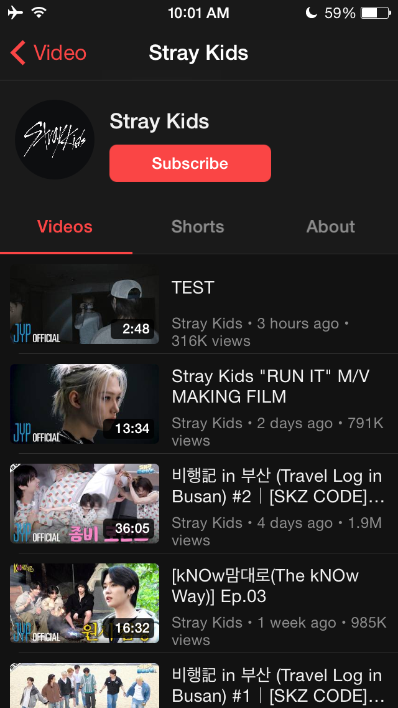 |

### iPad mini — iOS 8 (rotation + reflow)

| Home | Search | Results |
|---|---|---|
| 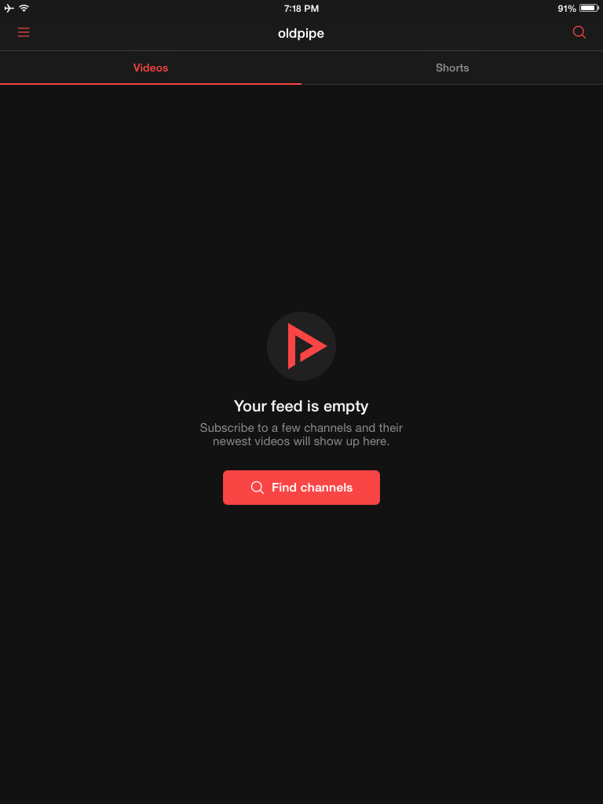 | 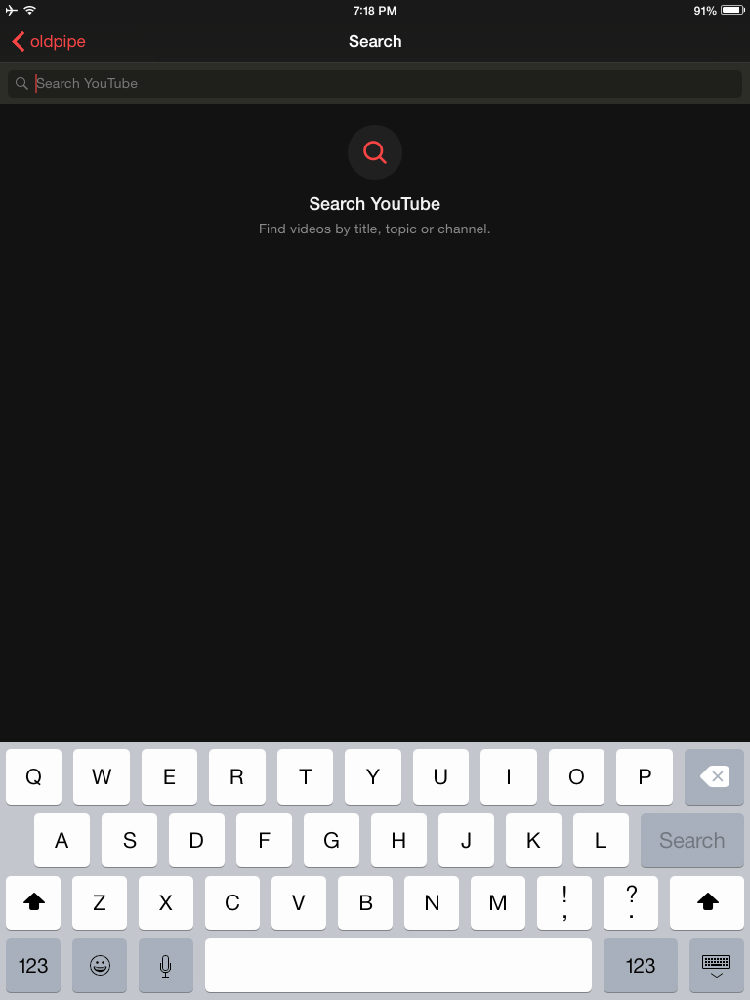 | 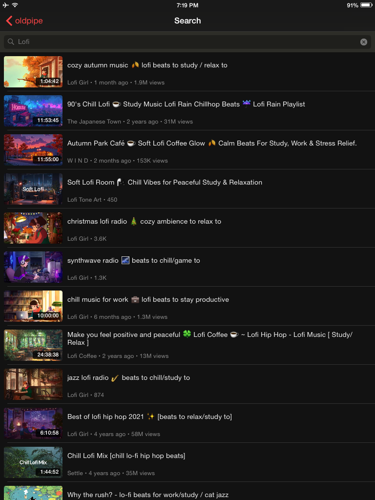 |

| Video (portrait) | Video (landscape) |
|---|---|
| 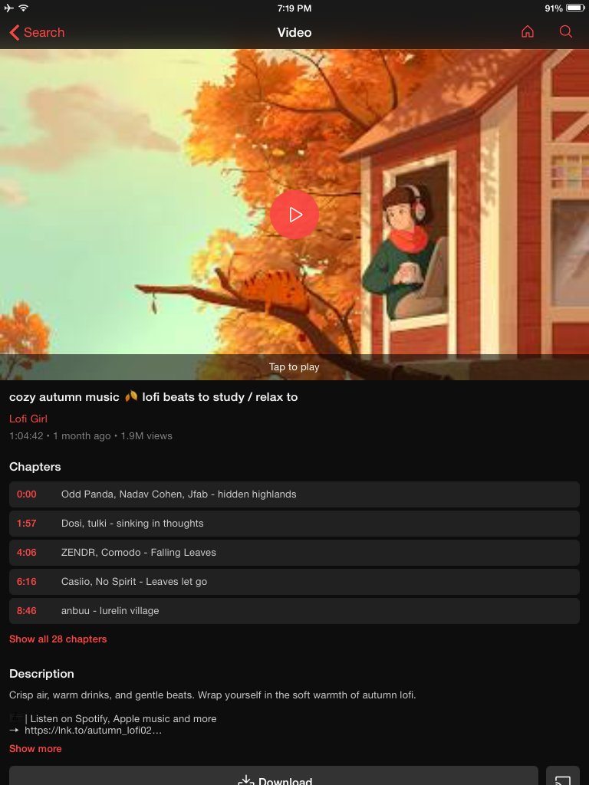 | 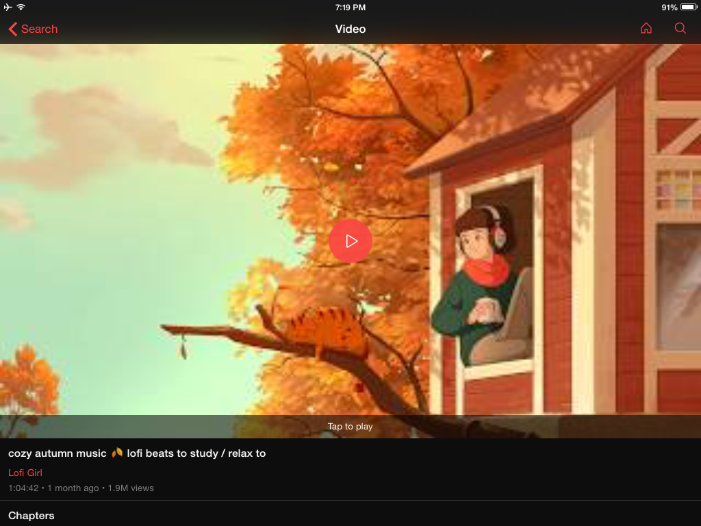 |

---

## Features

**Browsing**
- Search videos
- Channel pages — Videos / Shorts / Playlists / About, with subscribe
- YouTube playlists, opened from a channel's Playlists tab
- Subscriptions feed on the home screen, plus a feed per channel group
- Shorts in a TikTok-style vertical pager
- Related videos and comments, side by side in tabs on the video page
- Comments load in batches, with replies expandable inline

**Playback**
- Quality selection up to 1080p, 60 fps included, on iOS 5 and 6 too
- A 30 / 60 fps preference for videos that offer both
- Chapters
- Playback speed from 0.5x to 2x
- Captions / subtitles
- Background audio with lock-screen controls, artwork and Next
- Persistent mini player bar that survives navigation
- Double-tap the left/right edge to seek ±15s
- Resume where you left off, with each video's progress shown in History
- Autoplay-next through playlists, in order or shuffled
- Fullscreen with rotation

**Beyond the app**
- Download videos for offline playback — any quality or audio only, captions included
- Save any video to the Photos gallery, at any quality
- Save the audio as an M4A file, reachable through iTunes File Sharing
- Chromecast, with a remote in the mini player that picks the session back up after the
  phone sleeps
- Share links out to any app

**Library (all local)**
- Subscriptions, sortable into channel groups
- Playlists
- Watch history
- Downloads
- Backup and restore of subscriptions and playlists, as plain text

---

## Install

### Recommended — via the repo (Cydia / Sileo / Zebra)

Add this source:

```
https://cydia.rousseaddict.online
```

It carries every build below, iOS 5 included. The repo page also exposes a direct
**OTA install link**, so you can install straight from Safari on the device without a
package manager.

### Manual — sideload the IPA

Prebuilt IPAs live in [`build/`](build/). Pick the one that matches the device:

| File | Target | Notes |
|---|---|---|
| `build/oldpipe_ios5.ipa` | iOS 5 | Portrait-locked, armv7 only, about a third of the size. Ships its own Swift runtime (see [Building](#building)). |
| `build/oldpipe_ios6.ipa` | iOS 6 – 7 | Portrait-locked. The baseline build. |
| `build/oldpipe_ios7.ipa` | iOS 7 | Same as above, plus the layout fix for the translucent iOS 7 navigation bar. |
| `build/oldpipe_ios8.ipa` | iOS 8 – 12 | Adds iPad rotation and layout reflow. Tested as far up as iOS 12. |

The IPAs are **ad-hoc signed**, so they install on a jailbroken device
(Filza, `ipainstaller`, AppSync) but not on a stock one. To run on a stock device you must
re-sign the IPA with your own certificate.

---

## Tested on

| Device | OS | Build | Status |
|---|---|---|---|
| iPhone 4 | iOS 5.1.1 | `ios5` | Works |
| iPhone 4S | iOS 6 | `ios6` | Works |
| iPhone 5 | iOS 7 | `ios6` / `ios7` | Works, full 4-inch screen |
| iPad mini (1st gen) | iOS 8 | `ios8` | Works, rotation enabled |
| iPhone 5s | iOS 12 | `ios8` | Works |

---

## Known limitations

These are real, current, and mostly not fixable from inside the app:

- **No sign-in.** By design — but it also means no personal recommendations, no
  server-side subscriptions, and no liking or posting. Comments are read-only; your
  subscriptions are local only.
- **Playback speed only applies at 360p on iOS 5 and 6.** Above 360p the video is served
  to AVPlayer as HLS, and before iOS 7 the player honours only 1x for HLS. iOS 7 and later
  are unaffected.
- **Casting is limited to 360p.** The Chromecast needs a single self-contained file, which
  YouTube only offers at 360p — and not for every video, so a few cannot be cast at all.
  Streaming and downloading work at every quality.
- **Livestreams are limited.** They play, but seeking within them does not.
- **YouTube can break this at any time.** The app depends on undocumented internal
  endpoints and on client identities that Google periodically invalidates. When playback
  suddenly stops working everywhere, that is usually why — and it usually needs a new
  build to fix.

---

## How it works

Four problems had to be solved to make a modern video service work on an OS from
2011–2012:

1. **TLS.** iOS 5 and 6 only negotiate CBC cipher suites. YouTube and its CDN require AES-GCM,
   which arrived in iOS 7. Every HTTP request in the app therefore goes through a
   statically linked **libcurl 8.20 + OpenSSL 3.4**, bypassing the system TLS stack.

2. **AVPlayer.** AVPlayer has its own internal TLS stack and cannot be routed through
   libcurl. oldpipe runs a **loopback HTTP proxy** on the device: AVPlayer connects to
   `127.0.0.1`, the proxy fetches the real bytes over libcurl and relays them, including
   range requests, seeking and mid-stream resume.

3. **Quality above 360p.** Anything above 360p is delivered as separate DASH video and
   audio tracks, which iOS 5 and 6 cannot play. oldpipe **transmuxes fragmented MP4 into
   MPEG-TS on the fly** and serves the result to AVPlayer as an HLS stream, entirely on
   the device.

4. **Swift on iOS 5.** Swift was never meant to run before iOS 7, and iOS 6 only needs the
   version patches described under [Building](#building). iOS 5 needs more: its
   Objective-C runtime misreads a flag Swift sets on every class, it predates the
   `LC_MAIN` entry point, and it has none of the GCD queue objects Swift's Dispatch
   library is built on. The iOS 5 build ships a rebuilt Swift runtime, clears that flag,
   brings its own process entry point, and wraps GCD's C API instead.

---

## Building

Building requires macOS with **Xcode 13.2.1** and both the **Swift 5.6.3** and
**Swift 5.1.5** toolchains installed side by side.

The four targets come from the same source tree, separated by a compile-time flag:

| Target | Flag | Deployment |
|---|---|---|
| iOS 5 | `-D IOS5_TARGET` | armv7, linked with `-ios_version_min 5.0` |
| iOS 6/7 | `-D IOS6_TARGET` | 7.0, version-min patched to 6.0 |
| iOS 7 | `-D IOS7_TARGET` | 7.0 |
| iOS 8–12 | `-D IOS8_TARGET` | 8.0 |

The pipeline compiles with **5.6.3** — the 5.1.5 compiler cannot parse modern SDK headers
— then swaps the bundled Swift runtime dylibs for the **5.1.5** ones, which are the newest
that still run on iOS 6. Swift's ABI stability is what makes that combination work. The
`libswiftMetal` dylib is dropped (Metal does not exist before iOS 8, and A5/A6 chips never
supported it), `LC_VERSION_MIN_IPHONEOS` and `MinimumOSVersion` are patched down, and
everything is ad-hoc signed before being zipped into an IPA.

The iOS 5 build is assembled by [`ios5-shims/build-ios5.sh`](ios5-shims/build-ios5.sh) and
goes further: it ships a rebuilt Swift 5.1.5 runtime instead of the stock one (see
[`ios5-shims/prebuilt/`](ios5-shims/prebuilt/) for where it comes from), clears the flag
Swift sets on its classes, links its own process entry point, and thins and strips the
bundle down to armv7.

Because the iOS 6, 7 and 8 targets share one DerivedData directory, always run a **clean**
build when switching flags — Swift's incremental compiler will otherwise silently reuse
objects built with the previous flag. The iOS 5 build keeps its own.

---

## License

oldpipe is free software, licensed under the **GNU General Public License v3.0**.
See [`LICENSE.txt`](LICENSE.txt) for the full text.

```
Copyright (C) 2026 RousseAddict

This program is free software: you can redistribute it and/or modify it under the
terms of the GNU General Public License as published by the Free Software Foundation,
either version 3 of the License, or (at your option) any later version.

This program is distributed in the hope that it will be useful, but WITHOUT ANY
WARRANTY; without even the implied warranty of MERCHANTABILITY or FITNESS FOR A
PARTICULAR PURPOSE. See the GNU General Public License for more details.
```

Bundled third-party components:

| Component | License | GPL-3.0 compatible |
|---|---|---|
| libcurl 8.20.0 | curl (MIT-like) | Yes |
| OpenSSL 3.4.6 | Apache-2.0 | Yes |
| Swift 5.1.5 runtime | Apache-2.0 with Runtime Library Exception | Yes |
| Swift 5.1.5 runtime rebuilt for iOS 5, from the `ios5-v1.0` release of [zirk-a/oldpipe](https://github.com/zirk-a/oldpipe) (iOS 5 build only) | Apache-2.0 with Runtime Library Exception upstream; the rebuild's own changes carry no stated licence | Upstream yes — see [`ios5-shims/prebuilt/README.md`](ios5-shims/prebuilt/README.md) |
| [Phosphor Icons](https://phosphoricons.com) | MIT | Yes |
